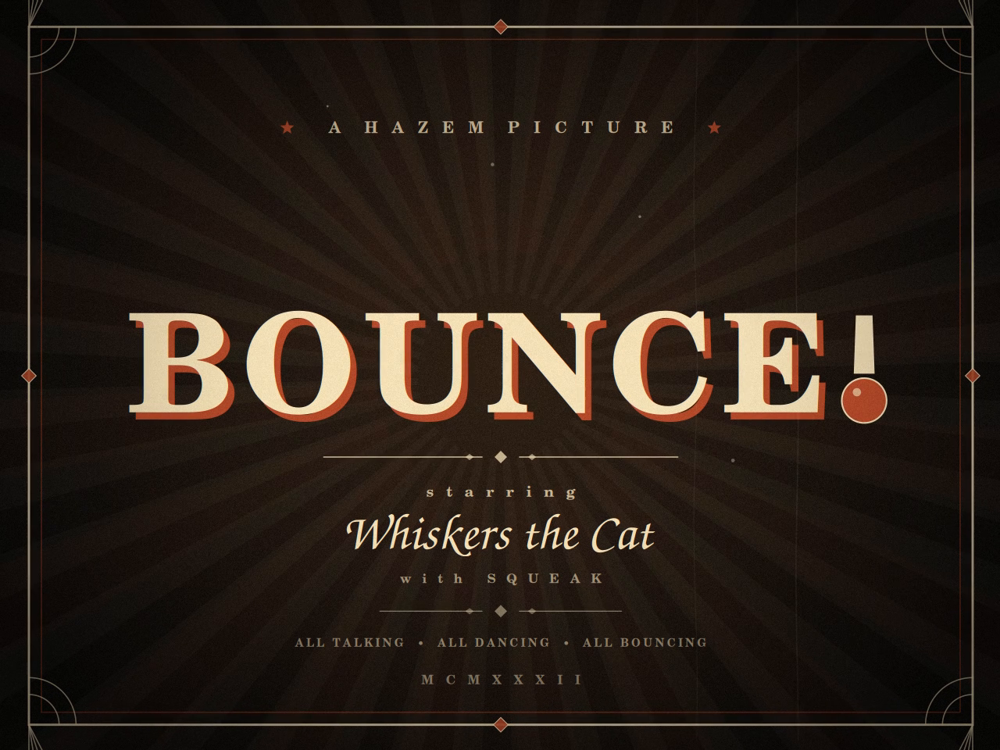

# BOUNCE! (1932)

**A HAZEM PICTURE — MCMXXXII**

A one-minute sepia rubber-hose cartoon starring **Whiskers the Cat** and **Squeak the Mouse**, with a hand-synthesized 1930s dance-band score, sing-along, film grain, gate weave, iris transitions and an art-deco title card.



## Watch

| File | Specs | Size |
| --- | --- | --- |
| `BOUNCE_1932.mp4` | 1280×960, 24 fps, H.264 + AAC 192k, 60.000 s | 173 MiB |
| `BOUNCE_1932_720p.mp4` | 960×720, 24 fps, H.264 + AAC, 60.000 s | 11 MiB |

The 720p file is the easy-sharing copy; the 1280×960 file is the high-bitrate master.

## Synopsis

Whiskers sleeps through his alarm, stretches, winds up the gramophone and dances a happy rubber-hose routine. Squeak sneaks out of the mouse hole, snatches the record and runs. The chase ends in a gramophone crash, a dazed count of stars — and the discovery that the wrecked gramophone makes a fine banjo. Cat and mouse finish with a duet, a confetti finale and a tip of the boater.

## Picture timeline

| Time | Beat |
| --- | --- |
| 0.00–4.05 | Art-deco title card; the exclamation-point ball drops and bounces |
| 4.05–7.13 | Iris opens on the living room; Whiskers asleep in the armchair |
| 7.13–11.25 | Alarm, startle, morning stretch |
| 11.25–14.95 | Winding the gramophone, needle drop |
| 14.95–23.72 | Dance routine and “OH, I’M A HAPPY LITTLE CAT / I BOUNCE ALL DAY!” sing-along |
| 23.72–33.35 | Record theft, chase, fight cloud, gramophone crash |
| 33.35–37.50 | Dazed aftermath, mouse returns, banjo discovered |
| 37.50–48.75 | Cat-and-mouse banjo/trumpet jam (with a 360° spin) |
| 48.75–54.25 | Confetti finale, bow, hat tip |
| 54.25–56.25 | Iris out |
| 56.25–60.00 | “THE END” card, bouncing full stop, “Shave and a Haircut” tag |

## Sound

The score is synthesized from scratch at **128 BPM**: 32 bars of 4/4 = exactly 60.0 seconds, so every gag lands on the grid. Instruments include piano, tuba, banjo, clarinet, trumpet, trombone, pizzicato strings and drums, plus cartoon SFX (alarm, boing, record scratch, whoosh, crash), a word-synced sing-along melody, vinyl surface noise, optical band-limiting and light reverb.

## Made with

- **pycairo** — all vector artwork and character animation, drawn in a 960×720 design space and rendered at 1280×960
- **NumPy / SciPy** — additive synthesis, envelopes, filters, reverb and the film-print post-process (grain, flicker, vignette, gate weave, dust and scratches)
- **FFmpeg** — raw-frame pipe encoding and soundtrack muxing

The film is 1,440 frames at 24 fps. The picture and soundtrack share the same absolute-time cue sheet (`timeline.py`), including the record grab at 23.72 s, the crash at 33.35 s, the jam at 37.50 s and the end-card tag at 56.25 s.

## Rebuild

```bash
python3 audio.py     # renders soundtrack.wav (60.000 s stereo)
python3 render.py    # renders 1,440 frames and muxes BOUNCE_1932.mp4
```

Requirements: Python 3 with `pycairo`, `numpy`, `scipy` and `Pillow`, plus `ffmpeg` on the PATH. On 8 cores the full render takes roughly 11 minutes; the 720p share copy can be made afterward with FFmpeg.

## Files

- `BOUNCE_1932.mp4` — final master
- `BOUNCE_1932_720p.mp4` — compact copy
- `poster.png` — title-card poster frame
- `contact_sheet.png` — 24-frame storyboard from the final film
- `soundtrack.wav` — 60 s stereo score
- `scene.py`, `characters.py`, `props.py`, `cards.py`, `gfx.py` — picture
- `audio.py`, `timeline.py` — score and shared cue sheet
- `render.py`, `stills.py` — encoding and frame-review tools

---

*Starring Whiskers the Cat, with Squeak. Any similarity to actual cats is purely coincidental.*
